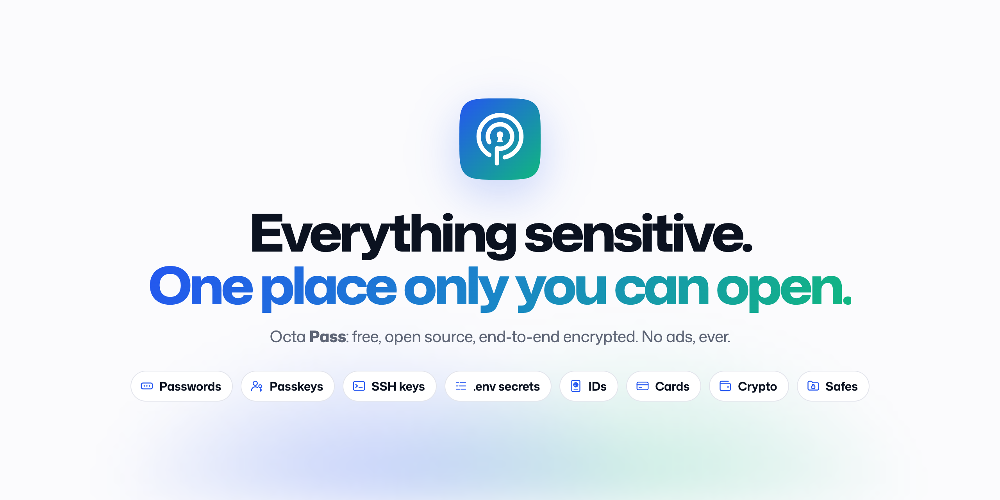
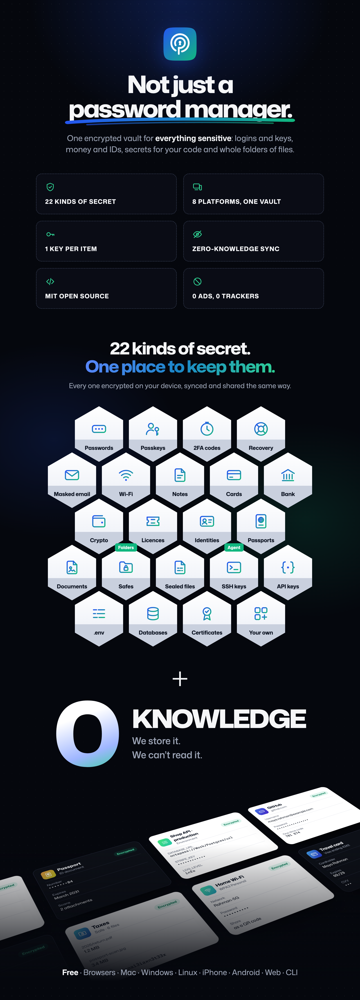
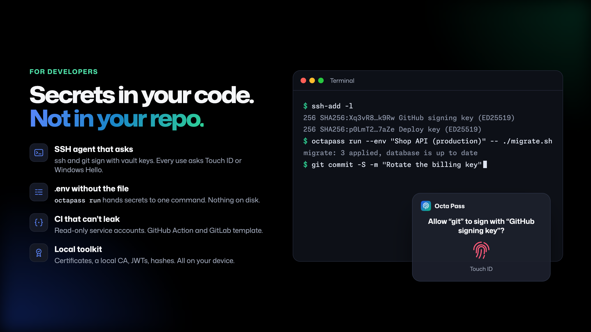

<p align="center">
  <picture>
    <source media="(prefers-color-scheme: dark)" srcset="brand/readme-header-dark.png">
    
  </picture>
</p>

<p align="center">
  <a href="https://octap.app"><b>Website</b></a> ·
  <a href="https://vault.octap.app"><b>Web vault</b></a> ·
  <a href="docs/index.md"><b>Docs</b></a> ·
  <a href="docs/security/overview.md"><b>Security design</b></a> ·
  <a href="plans/09-roadmap.md"><b>Roadmap</b></a> ·
  <a href="changelog/"><b>Changelog</b></a>
</p>

<p align="center">
  <a href="LICENSE"></a>
  <a href="https://vault.octap.app"></a>
  
  <a href="CONTRIBUTING.md"></a>
  <a href="https://octap.app/llms.txt"></a>
</p>

---

**Octa Pass keeps everything sensitive in one place only you can open.** It's a full password manager for every login, passkey and one-time code you own, and it doesn't stop there: your SSH keys, API keys and `.env` files, cards and bank accounts, passports and IDs, crypto wallets, Wi-Fi networks and whole folders of files live in the same vault. Create an account, install the apps, and it syncs to every browser, phone and computer, encrypted on your device so even we can't read it. No trial, no ads.

<p align="center">
  
</p>

The code is open source, so anyone can check how it protects you, and organisations can run their own server with the same apps.

> [!IMPORTANT]
> **Octa Pass is in public alpha.** You can create a free account in the [web vault](https://vault.octap.app) today, and install the browser extension from the [Chrome Web Store](https://chromewebstore.google.com/detail/octa-pass/jainmncaocgdhknhcjkdbbbmahllbjol) or [Firefox Add-ons](https://addons.mozilla.org/firefox/addon/octa-pass/). The core, server, browser extensions, desktop apps, native phone apps and CLI are all in this repository; the other apps are coming to the stores, and nothing has had its external security audit yet, so keep a backup of anything important. **Reviews of the security design and the code are the most useful contribution right now.** Follow the [changelog](changelog/) for progress.

## Why Octa Pass

- **Free, with nothing to set up.** Unlimited passwords, passkeys and devices, family sharing for up to 6 people, and 1 GB for files. Funded by donations, sponsors and grants.
- **Zero-knowledge by design.** Argon2id, a 128-bit Secret Key, XChaCha20-Poly1305 with per-item keys, and OPAQUE login (your password never crosses the network). [How it works](docs/security/encryption.md)
- **Everything sensitive in one vault.** Passwords, passkeys, TOTP codes, cards, bank accounts, crypto wallets, passports and IDs, Wi-Fi networks, secure notes, documents and software licences. [All 22 kinds](docs/features/item-types.md)
- **Your files, locked.** [Safes](docs/features/octa-pass-safe.md) are folders that lock with your vault, with every file and name encrypted on disk. [Encrypt files](docs/features/file-encryption.md) in the open age format for yourself or anyone else.
- **Secrets for developers.** [SSH keys with an SSH agent](docs/features/ssh-keys.md) that asks before it signs, [`.env` files](docs/features/environments.md) handed to one command with `octapass run`, [service accounts](docs/features/service-accounts.md) for CI, and a [local toolkit](docs/features/developer-toolkit.md) for certificates and JWTs.
- **Recovery info and masked email.** Record which email or phone recovers each account and track backup codes. Generate a forwarding alias per site.
- **Everywhere you sign in.** Browser extensions, desktop and mobile apps with native autofill and passkey support, a web vault and a CLI.
- **No lock-in.** Full export to CSV, encrypted JSON and the FIDO Credential Exchange Format, passkeys included.
- **No ads, no trackers.** Not on the website, not in the apps.
- **Open source, so you don't have to trust us.** MIT, and the service runs exactly this code.

## For developers

<p align="center">
  
</p>

## Platforms

| Platform | Autofill | Passkeys | Unlock | State |
|---|---|---|---|---|
| Chrome · Edge · Brave · Firefox | In-page fill and save | ✅ | Password, desktop app, passkey (PRF) | [Chrome Web Store](https://chromewebstore.google.com/detail/octa-pass/jainmncaocgdhknhcjkdbbbmahllbjol) · [Firefox Add-ons](https://addons.mozilla.org/firefox/addon/octa-pass/) |
| macOS (native) | System AutoFill + Safari, Safes in Finder | ✅ | Touch ID / Mac password | Built |
| Windows (Tauri) | Extension + auto-type | In browser (system-wide planned for 1.0) | Windows Hello | Built |
| Linux (Tauri) | Extension + auto-type | In browser | polkit / password | Built |
| iOS · iPadOS (native) | System AutoFill | ✅ | Face ID / Touch ID | Built |
| Android (native) | Autofill + Credential Manager | ✅ (14+) | Biometrics | Built |
| Web vault · CLI | Copy / view | n/a | Password | Built |

Details and limits: [support matrix](docs/platforms/support-matrix.md).

## Run your own server (optional)

Most people should just use the free Octa Pass service. If your organisation needs its own server, run the same server code (one container, SQLite or Postgres) and point the **same official apps** at it: choose **Self-hosted** at sign-in and enter your server's address. Autofill, passkeys and biometrics work the same. See [connect the apps to your server](docs/self-hosting/connect-apps.md).

## Roadmap

| Phase | Ships | State |
|---|---|---|
| 0. Foundations | Plans, security design, docs website, brand | Mostly done |
| 1. Core + server + CLI | Rust core (crypto, vault, sync), sync server, CLI | Built |
| 2. Browser extensions | Autofill, passkeys, imports. **Public alpha** | Released: Chrome Web Store, Firefox Add-ons |
| 3. Desktop apps | Native macOS app; Windows and Linux (Tauri) with biometric unlock | Built, not released |
| 4 and 5b. Phone apps | Native iOS and Android apps with autofill. **Public beta** | Built, not released |
| 5. Sharing & completeness | Shared vaults, families, emergency access, masked email | Built, with gaps |
| 7. Growth features | Windows passkeys, SSH agent, teams, watch apps, post-quantum sharing | In 1.0, being built |
| 8. Developer toolkit and file safe | Keys, certificates, JWT tools, Connect, file encryption, Octa Pass Safe | In 1.0, started |
| 6. Audit → 1.0 | Independent security audit, published in full | Last step |

Everything that was planned for after 1.0 moved inside 1.0 on 2026-11-02. Full plan with status, estimates and exit criteria: [`plans/09-roadmap.md`](plans/09-roadmap.md).

## Architecture at a glance

```
React UI ─► Web vault · Extension · Desktop (Tauri: Windows, Linux) · CLI
SwiftUI (iPhone, iPad, Mac) · Compose (Android) ─► UniFFI (octapass-mobile) + native autofill
                                    │  every client links the same core
                     crates/octapass-core (Rust: crypto · vault · sync · TOTP · passkeys · import)
                                    │  ciphertext only, over TLS 1.3
                     apps/server (Rust · axum · OPAQUE · Postgres/SQLite · S3)
```

More: [architecture](docs/developers/architecture.md) · [sync API](docs/developers/sync-api.md) · [threat model](docs/security/threat-model.md) · [what the server sees](docs/security/what-the-server-sees.md)

## Repository

| Path | Contents |
|---|---|
| [`plans/`](plans/) | Product and engineering plans: decisions, architecture, security model, roadmap |
| [`docs/`](docs/) | Public documentation, served on the website at `/docs/` |
| [`changelog/`](changelog/) | One dated file per notable change, served at `/changelog/` with RSS |
| [`skills/octapass-docs/`](skills/octapass-docs/) | Agent skill that lets AI agents search and cite the docs |
| [`skills/octapass-cli/`](skills/octapass-cli/) | Agent skill that teaches AI agents to use the `octapass` CLI without exposing secrets |
| [`brand/`](brand/) | Logo, colours, type, voice and image sources |
| [`apps/website/`](apps/website/) | Astro + Starlight website: landing page, docs, changelog, `llms.txt`, in English and Arabic |
| [`apps/`](apps/), [`crates/`](crates/), [`packages/`](packages/) | The server, web vault, extension, the native Mac, iOS and Android apps, the Windows and Linux desktop app, and the Rust core. See [architecture](docs/developers/architecture.md) |
| [`apps/macos/`](apps/macos/) | The native Mac app: the iPhone app's SwiftUI screens, AutoFill, Safes in Finder, the browser extension's bridge, the CLI session and the SSH agent. See [its README](apps/macos/README.md) |
| [`apps/cli/`](apps/cli/) | The `octapass` command-line tool (preview): items, one-time codes, the generator, `octapass run` for secrets in scripts, import and export. See [CLI](docs/platforms/cli.md) |
| [`apps/vscode/`](apps/vscode/), [`apps/jetbrains/`](apps/jetbrains/) | IDE extensions: thin clients of [Octa Pass Connect](docs/features/connect.md) |
| [`integrations/`](integrations/) | The GitHub Action and GitLab CI template for [service accounts](docs/features/service-accounts.md) |

## Run the website locally

```bash
pnpm install    # Node 22+, pnpm 11
pnpm dev        # http://localhost:4321
pnpm build      # static site in apps/website/dist
```

Set `PUBLIC_SITE_URL` and `PUBLIC_REPO_URL` at build time once the domain and repo exist (defaults are placeholders).

## For AI agents

The docs are built to be read by machines too:

- [`/llms.txt`](https://octap.app/llms.txt), `/llms-small.txt` and `/llms-full.txt`
- Every docs page as Markdown: add `.md` to its URL (e.g. `/docs/security/encryption.md`)
- The [`octapass-docs` skill](skills/octapass-docs/SKILL.md) with a zero-dependency search script. Copy the folder into `~/.claude/skills/` (or your agent's skills folder).
- The [`octapass-cli` skill](skills/octapass-cli/SKILL.md), so an agent can use the `octapass` CLI for you: reading items, running commands with secrets injected, CI with service accounts. Its rules keep secrets out of the agent's output, and its tests check every command it names against the CLI's `--help`.
- Repository rules for agents: [`AGENTS.md`](AGENTS.md)

## Contributing

Design reviews, code, docs and translations are all welcome. Start with [`CONTRIBUTING.md`](CONTRIBUTING.md). Report security issues privately: see [`SECURITY.md`](SECURITY.md).

## License

[MIT License](LICENSE). The Octa Pass name and logo are project trademarks; see [`brand/`](brand/README.md).
