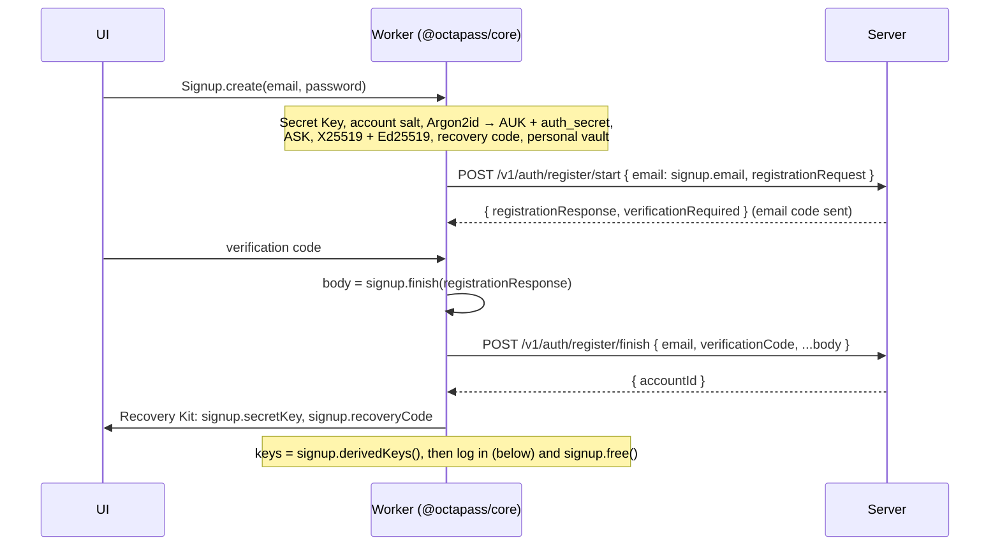
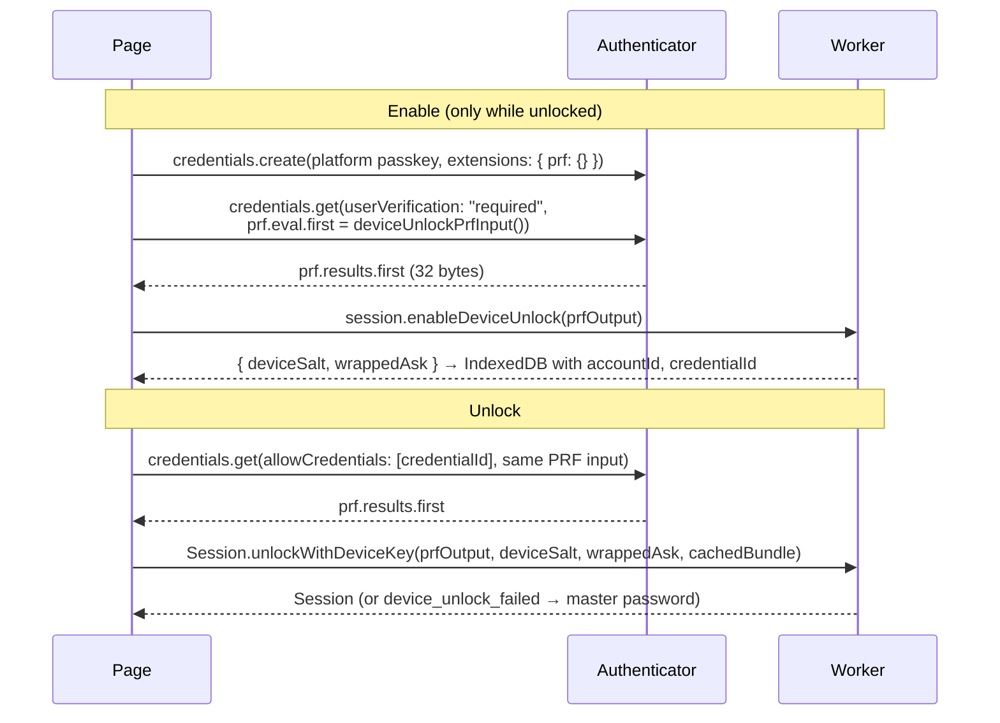
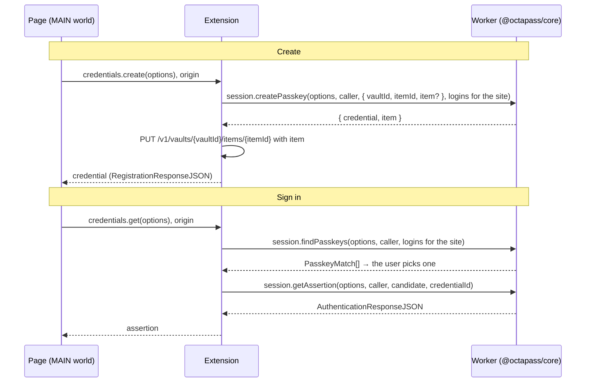

# octapass-wasm

WebAssembly bindings of [`octapass-core`](../octapass-core/) for the web vault. It's published inside the repo as the npm package **`@octapass/core`** (`packages/core`).

The API is designed to run in a **Web Worker**. Secrets stay in WASM memory behind handle classes. JavaScript only receives:

- what it must send to the server (OPAQUE messages, the account bundle, ciphertext),
- the two display strings it must show once at sign-up (Secret Key and recovery code),
- decrypted items, only when it asks for one.

Calling `free()` on a handle (or `using` it, since handles implement `Symbol.dispose`) zeroes the keys inside. **Locking the vault means freeing the `Session`.**

## Build and test

```sh
pnpm --filter @octapass/core build   # wasm-pack: dist/web (browser) and dist/node (tests)
pnpm --filter @octapass/core test    # node:test: the account flow, importers, matching, rules and local mode through WASM
pnpm --filter @octapass/core bench   # Argon2id unlock time
```

The build needs `wasm-pack` (`cargo install wasm-pack --locked`) and the `wasm32-unknown-unknown` target, which `rust-toolchain.toml` installs.

| Output | Target | Contents |
|---|---|---|
| `dist/web` → `@octapass/core` | `--target web` (ES module) | Everything below except `estimateStrength`. Call the default export `init()` once before use. |
| `dist/node` → `@octapass/core/node` | `--target nodejs` (CommonJS) | The same, plus `TestOpaqueServer` (feature `test-server`) for tests |

### In the browser worker (Vite)

```ts
import init, { DerivedKeys, Session, Signup } from '@octapass/core';
import wasmUrl from '@octapass/core/octapass_core_bg.wasm?url';

await init({ module_or_path: wasmUrl });
```

Keep `@octapass/core` out of Vite's dependency pre-bundling (`optimizeDeps: { exclude: ['@octapass/core'] }`) so the `.wasm` file resolves. Argon2id blocks the thread for a few hundred milliseconds, which is why all of this belongs in a worker.

## API

All types are in the generated `octapass_core.d.ts`. Binary values are base64url without padding. Field names match the [HTTP API](../../plans/11-milestone-1-web-vault.md#http-api-v1-c-implements-d-consumes).

| Handle / function | Purpose |
|---|---|
| `Signup.create(email, password)` | New account: every key, Argon2id, OPAQUE registration start |
| `signup.email`, `.registrationRequest` | For `register/start` |
| `signup.finish(registrationResponse)` → `RegisterFinish` | `{ registrationUpload, account, personalVault }` for `register/finish` |
| `signup.secretKey`, `.recoveryCode` | Display strings for the Recovery Kit |
| `signup.derivedKeys()` → `DerivedKeys` | Log in right after sign-up without running Argon2id again |
| `DerivedKeys.derive(email, password, secretKey, prelogin)` | Argon2id + HKDF with the `prelogin` response. Refuses KDF parameters weaker than the defaults. |
| `keys.startLogin()` → `LoginFlow` | `flow.credentialRequest` for `login/start` |
| `flow.finish(credentialResponse)` → `credentialFinalization` | For `login/finish`. Throws `login_failed` for a wrong password or Secret Key. |
| `keys.unlock(account)` → `Session` | Opens the account bundle (from `login/finish` or the local cache) |
| `Session.recover(recoveryCode, account)` → `Session` | Opens the account with the recovery code |
| `session.enableDeviceUnlock(prfOutput)` → `DeviceUnlock` | `{ deviceSalt, wrappedAsk }` for this device's IndexedDB (below) |
| `Session.unlockWithDeviceKey(prfOutput, deviceSalt, wrappedAsk, account)` → `Session` | Device unlock: Touch ID, Windows Hello, device passcode |
| `deviceUnlockPrfInput()` | The WebAuthn PRF input, `SHA-256("octapass/v1/device-unlock")` |
| `session.openVault(vaultId, wrappedVaultKey)` | Opens a vault from a `VaultRecord` |
| `session.encryptItem(vaultId, itemId, item, existingEncryptedItemKey?)` → `EncryptedItem` | Body for `PUT /v1/vaults/{vaultId}/items/{itemId}` |
| `session.decryptItem(vaultId, itemId, encrypted)` → `ItemPlaintext` | The whole item |
| `session.decryptOverview(vaultId, itemId, encrypted)` → `ItemOverview` | Just the overview, for lists and search |
| `session.startReauth(password, secretKey)` → `ReauthFlow` | Re-authentication before a dangerous action (below) |
| `session.account` | The `AccountBundle` the session was opened from |
| `session.newAttachment(vaultId, itemId, encryptedItemKey, attachmentId)` → `AttachmentEncryptor` | A new file key wrapped by the item key (`encryptor.wrappedKey`, for the item's details); `push(bytes)` and `finish()` return the encrypted file in pieces, for `PUT …/attachments/{attachmentId}` |
| `session.openAttachment(vaultId, itemId, encryptedItemKey, attachmentId, wrappedKey)` → `AttachmentDecryptor` | `push(bytes)` returns verified plaintext of complete chunks, `finish()` the rest; throws `decryption_failed` if the file was cut short or changed, so discard what came before |
| `attachmentEncryptedSize(size)` | Bytes a file of `size` takes once encrypted, as the server counts it |
| `newId()` | A UUIDv7 for a new item or vault |
| `session.createPasskey(options, caller, target, others)` → `PasskeyCreated` | `navigator.credentials.create()`: a passkey stored in `target`, as `{ credential, item }` ([passkeys](#passkeys)) |
| `session.findPasskeys(options, caller, candidates)` → `PasskeyMatch[]` | The passkeys that can answer a `navigator.credentials.get()`, without their keys |
| `session.getAssertion(options, caller, candidate, credentialId)` → `AuthenticationResponseJSON` | Signs in with one of them |
| `session.createSharedVault()` → `NewSharedVault` | `{ id, keyId, grant }` for `POST /v1/vaults`; the vault is open in the session ([sharing](#sharing)) |
| `session.grantVault(vaultId, recipient)` → `SignedGrant` | Seals an open vault's key to `{ accountId, publicEncKey, role }` and signs it |
| `session.openSharedVault(grant, granterPublicSignKey)` | Verifies a shared vault's grant and opens the vault. Throws `invalid_signature`. |
| `session.vaultKeyId(vaultId)` | The open vault key's id, to compare with a `VaultRecord`'s `keyId` |
| `session.rotateVaultKey(vaultId, members, items)` → `VaultRotation` | After removing a member: new key, grants for everyone who stays, item keys re-wrapped |
| `keyFingerprint(publicEncKey, publicSignKey)` → `Fingerprint` | `{ digits, emoji }` to compare out of band |
| `createShareLink(item, passphrase?)` → `ShareLink` | `{ ciphertext, key, passphraseRequired }`: upload `ciphertext`, put `key` in the link's `#` fragment |
| `shareLinkNeedsPassphrase(ciphertext)`, `openShareLink(ciphertext, key, passphrase?)` → `ItemPlaintext` | The viewer's side. Throws `wrong_passphrase` or `invalid_share_link`. |
| `session.sealForEmergencyContact(contactAccountId, contactPublicEncKey, scope)` | The ASK or one open vault's key, sealed for `POST /v1/emergency-contacts` |
| `session.openEmergencyAccount(grantor, sealed)` → `Session` | As the contact, after release: a session for the grantor's account |
| `session.openEmergencyVault(grantorAccountId, vaultId, sealed)` | As the contact, after release: opens that one vault |
| `generatePassword(options)` | Random password or passphrase (`GeneratorOptions`) |
| `estimateStrength(password, userInputs?)` | `{ score, guessesLog10, feedback? }` (zxcvbn). Only with the `strength` feature, so not in `dist/web`. |
| `totpCode(totp, atUnixSeconds?)` | `{ code, period, remaining }` |
| `parseOtpMigration(uri)` | Google Authenticator export → `otpauth://` URIs |
| `breachPrefix(password)`, `breachCount(password, rangeResponse)` | Pwned Passwords k-anonymity check; the full hash never reaches JS |
| `normalizeSecretKey(text)` | Validates a typed Secret Key, returns `OP1-…` |
| `importFile(source, bytes, options?)` → `ImportResult` | Parses another app's export on the device (below) |
| `previewCsv(bytes)` → `CsvPreview` | Headers, first rows and a suggested `ColumnMapping` for the generic CSV screen |
| `matchItems(url, items, options?)` → `ItemMatch[]` | Which items belong to a page, best first (below) |
| `registrableDomain(urlOrHost)` | eTLD+1 from the Public Suffix List, in punycode, or `undefined` |
| `parsePasswordRules(text)` → `PasswordRules` | Apple `passwordrules` syntax; never throws |
| `passwordRulesTextForSite(url)` | The embedded per-site rules text, if the site has any |
| `generateForRules(rules, options?)` | A password that satisfies the rules, close to the user's generator settings |
| `LocalVault.create(password, options?)` → `LocalVault` | A vault on this device only (below) |
| `LocalVault.unlock(blob, password, hardwareSecret?)`, `LocalVault.restoreBackup(file, secret, password, options?)` | Open a stored vault, or restore a backup onto this device |
| `vault.toBytes()`, `.list()`, `.getItem(id)`, `.addItem(item)`, `.updateItem(id, item)`, `.deleteItem(id)`, `.restoreItem(id)`, `.purgeItem(id)` | Store and edit the local vault |
| `vault.createBackup()`, `.backupRecoveryCode`, `.changePassword(newPassword, options?)` | Backups and the local Recovery Kit |
| `vault.upgradeToAccount(email, password)` → `Signup`, `vault.items()` | Turn on sync |

An item is `{ overview, details }` as in the [item model](../../plans/11-milestone-1-web-vault.md#item-model-a-defines-the-ts-types-b-mirrors-them-in-rust-serde-d-maps). `schemaVersion: 1` is added when missing, and unknown fields round-trip untouched.

Every flow method that consumes protocol state (`signup.finish`, `flow.finish`, `reauth.finish`) works once; a second call throws `flow_finished`.

### Import

`importFile(source, bytes, options?)` takes the file's bytes (UTF-8, or UTF-16 with a BOM) and returns `{ items, totpUpdates, warnings, skipped }`. `items` are `ItemPlaintext`s ready for `encryptItem` or `vault.addItem`; nothing is sent anywhere.

| `source` | File | `options` |
|---|---|---|
| `"chrome"` | Chrome, Edge, Brave, Opera, Vivaldi, Arc CSV | |
| `"firefox"` | Firefox CSV | |
| `"safari"` | Safari / Apple Passwords CSV | |
| `"bitwarden-json"` | Bitwarden or Vaultwarden JSON, plain or password protected | `{ password }` for protected exports |
| `"onepassword-1pux"` | 1Password `.1pux` | |
| `"onepassword-csv"` | 1Password CSV | |
| `"lastpass-csv"` | LastPass CSV, including `NoteType:` notes | |
| `"generic-csv"` | Any CSV with a header row (`,` `;` or tab) | `{ columns: ColumnMapping }` from the mapping screen, or none to recognise columns by name |
| `"otpauth"` | `otpauth://` and Google Authenticator `otpauth-migration://` links, one per line | `{ existingLogins: [{ id, title, urls, username?, hasTotp? }] }` |

For authenticator imports, codes that belong to an existing login come back in `totpUpdates` (`{ itemId, totp }`: set that item's `details.totp`); the rest are new logins in `items`. Columns and fields the item model has no place for become custom fields (logins) or `Label: value` note lines (other types). `warnings` are short English sentences without secrets, capped at 20.

Errors: `invalid_import_file` (not this format; the message is a sentence to show), `import_password_required`, `wrong_import_password`, `unsupported_import` (a Bitwarden export locked to its account). Remind the user to delete the export file afterwards (plan 07).

### Matching and password rules

`matchItems(pageUrl, items, options?)`: `items` are `{ id, ...overview }`, so the overview's `urls` and optional `urlMatch: { [url]: "subdomains" | "baseDomain" | "host" | "startsWith" | "regex" | "never" }` are read and the rest ignored. A URL without a mode uses `subdomains`: the page's own host, a domain above it or a host below it, never another part of the domain (`shop.example.com` on `login.example.com`); `baseDomain` matches every part. Options: `defaultMode` (default `"subdomains"`), `equivalentDomains` (extra groups), `defaultEquivalents` (default `true`). The result is one `{ id, url, quality: "exact" | "domain" | "equivalent", schemeMismatch }` per matching item, best first: own host, the domains above it (nearest first), hosts below it, then equivalent domains. `otherParts(pageUrl, items, options?)` returns the logins left out for being on another part of the domain, as `{ id, url, host, site, schemeMismatch }` sorted by host, for a "Logins for other parts of {site}" entry the user opens by hand; `websiteForPage(pageUrl)` is the origin to add to one the user filled from there. Look-alikes (`paypal.com.evil.io`, `paypal.com@evil.io`, homographs) never match; warn before filling when `schemeMismatch` is set and the page is `http`.

Suggested passwords: join the site's rules text (`passwordRulesTextForSite(url)`), the field's `passwordrules` attribute and its `minlength`/`maxlength` (as `minlength: 8;`) with `;`, then `generateForRules(parsePasswordRules(text), userGeneratorOptions)`. It throws `invalid_password_rules` only when no password can satisfy the rules.

### Local mode

A `LocalVault` is a vault with no account, for the browser extension and later the apps (never the web vault, plan 05). The key hierarchy below the ASK is the account one, so turning on sync uploads the items as they are. Formats: [`crates/octapass-core/README.md`](../octapass-core/README.md#local-mode).

- `LocalVault.create(password, { memoryKib?, hardwareSecret? })`: Argon2id at 256 MiB by default (`memoryKib: 65536` on low-memory devices). `hardwareSecret` is 32 bytes from the device chip (through the desktop app, for the extension); without it the password must score 4 with zxcvbn or `create` throws `weak_master_password`. Show `vault.backupRecoveryCode` in the local Recovery Kit.
- Store `vault.toBytes()` after every change; `LocalVault.unlock(blob, password, hardwareSecret?)` opens it (`login_failed`, `hardware_secret_required`). Item ids are UUIDv7s; `deleteItem` moves to the trash (`deletedAt`), `purgeItem` removes for good. Times are Unix milliseconds.
- `vault.createBackup()` returns a `.octapass-backup` file (no password needed: the backup key was derived at creation). `LocalVault.restoreBackup(file, { password } | { recoveryCode }, password, options?)` restores it on any device; with the recovery code, `password` is the new master password.

```mermaid
sequenceDiagram
    participant W as Worker
    participant S as Server
    Note over W: Turn on sync (vault unlocked)
    W->>W: signup = vault.upgradeToAccount(email, password)
    Note over W: new Secret Key, account salt, recovery code;<br/>ASK re-wrapped by the AUK; same key pairs and vault
    W->>S: POST /v1/auth/register/start { email: signup.email, registrationRequest }
    S-->>W: { registrationResponse }
    W->>W: body = signup.finish(registrationResponse)
    W->>S: POST /v1/auth/register/finish { email, verificationCode, ...body }
    Note over W: then log in as after any sign-up
    W->>S: POST /v1/batch: put every vault.items() entry into body.personalVault.id (unchanged ciphertext)
    W->>W: show the Recovery Kit (signup.secretKey, signup.recoveryCode), delete the local blob
```

### Errors

Everything throws a JS `Error` with `name === "OctaPassError"` and a stable `code` (type `OctaPassErrorCode`). Messages never contain secrets. The codes a UI usually needs:

| Code | Meaning |
|---|---|
| `login_failed` | Wrong master password or Secret Key (local unlock, OPAQUE login or reauth) |
| `device_unlock_failed` | The passkey's PRF output, device salt and wrapped ASK don't open this account: fall back to the master password |
| `invalid_secret_key`, `invalid_recovery_code` | Typo, or the recovery code isn't this account's |
| `unsupported_kdf` | The server sent KDF parameters below the minimum |
| `vault_not_open` | `openVault` wasn't called for this vault in this session |
| `invalid_item`, `invalid_id`, `invalid_argument` | The caller passed something malformed |
| `invalid_import_file`, `import_password_required`, `wrong_import_password`, `unsupported_import` | Import problems (see *Import*) |
| `invalid_url` | `matchItems` was given a page that isn't an http(s) address |
| `invalid_password_rules` | No password can satisfy these rules |
| `weak_master_password`, `hardware_secret_required`, `invalid_local_vault`, `invalid_backup`, `item_not_found` | Local mode (see *Local mode*) |
| `decryption_failed`, `wrong_key`, `key_mismatch` | Ciphertext was tampered with, moved, or encrypted for another key |
| `passkey_rp_mismatch` | The page may not use that `rpId`, or its origin isn't secure: answer the page with `SecurityError` |
| `passkey_frame_not_allowed` | A cross-origin frame asked; ask the user to allow it, or answer `NotAllowedError` |
| `passkey_excluded` | The user already has a passkey in `excludeCredentials`: `InvalidStateError` |
| `passkey_unsupported_algorithm` | Neither ES256 nor EdDSA was offered: `NotSupportedError` |
| `passkey_not_found` | No passkey matches the request: `NotAllowedError` |
| `invalid_passkey_request` | The page's options are malformed: `TypeError` |
| `invalid_signature` | A grant wasn't signed by the key you checked it against, or was changed: don't use the vault, warn the user |
| `invalid_grant` | The grant is for another vault or account |
| `wrong_passphrase`, `invalid_share_link` | A share link's passphrase is missing or wrong, or its key doesn't match |

## Sequences

### Sign-up



The device stores the Secret Key locally (it's needed for every unlock). The recovery code goes only into the Recovery Kit.

### Login

```mermaid
sequenceDiagram
    participant W as Worker
    participant S as Server
    W->>S: POST /v1/auth/prelogin { email }
    S-->>W: prelogin = { kdf, accountSalt }
    W->>W: keys = DerivedKeys.derive(email, password, secretKey, prelogin)
    W->>W: flow = keys.startLogin()
    W->>S: POST /v1/auth/login/start { email, credentialRequest: flow.credentialRequest }
    S-->>W: { loginId, credentialResponse }
    W->>W: credentialFinalization = flow.finish(credentialResponse)
    W->>S: POST /v1/auth/login/finish { loginId, credentialFinalization, device }
    S-->>W: { accessToken, refreshToken, expiresIn, account }
    W->>W: session = keys.unlock(account); keys.free()
    W->>S: GET /v1/sync
    S-->>W: { vaults, items, deleted }
    W->>W: session.openVault(v.id, v.wrappedVaultKey) for each vault,<br/>session.decryptOverview(...) for the list
```

On a new device the user types the Secret Key; on a known device it comes from local storage.

### Lock and unlock

Lock: `session.free()`. Unlock with the master password, without the server: `DerivedKeys.derive(email, password, secretKey, { kdf, accountSalt })` from the cached bundle, then `keys.unlock(cachedBundle)` and re-open the vaults. A wrong password throws `login_failed`.

### Device unlock

Unlock with the device's own lock (Touch ID, Face ID, Windows Hello PIN, device passcode) through a platform passkey and the WebAuthn **PRF** extension. The worker never sees the passkey, only its 32-byte PRF output, and nothing goes to the server.

```text
device_key = HKDF-SHA256(ikm = prfOutput, salt = deviceSalt (16 random bytes), info = "octapass/v1/device-unlock")
wrappedAsk = XChaCha20-Poly1305 envelope of the ASK under device_key, context "device-unlock"
```



`unlockWithDeviceKey` also checks that the unwrapped key opens this bundle's private keys, so a stored record for another account fails cleanly. The 14-day master-password rule and deleting the record on sign-out are the caller's job (see the contract).

### Passkeys

The browser extension answers `navigator.credentials.create/get` with the core authenticator when the user picks Octa Pass. Options and responses are the WebAuthn Level 3 JSON forms (`PublicKeyCredentialCreationOptionsJSON`, `RegistrationResponseJSON`, …): the extension converts the page's `BufferSource`s to base64url, and the response's base64url fields back into `ArrayBuffer`s for the page. The byte formats are in the [core README](../octapass-core/README.md#passkeys).

Every call takes the `PasskeyCaller` the extension observed: `{ origin, topOrigin?, frameAllowed? }`. The core refuses origins that aren't `https` (or `http://localhost`), `rpId`s that aren't the origin's host or a registrable-domain suffix of it, and cross-origin frames unless `frameAllowed`. The calls work on encrypted items (`PasskeyCandidate = { vaultId, itemId, item }`), so the private key stays in WASM.



Only call these after the user chose Octa Pass for this request in an unlocked vault: the authenticator always reports the user as present and verified.

### Sharing

```ts
// Owner: create a shared vault, then invite someone.
const vault = session.createSharedVault();                 // POST /v1/vaults
const bob = await api.lookup('bob@example.com');           // GET /v1/accounts/lookup
// Compare keyFingerprint(bob.publicEncKey, bob.publicSignKey) with Bob out of band.
const grant = session.grantVault(vault.id, { accountId: bob.accountId, publicEncKey: bob.publicEncKey, role: 'write' });
await api.invite(vault.id, { email: 'bob@example.com', grant });

// Member: open shared vaults from sync. The grant is the VaultRecord plus its `grant` half.
for (const v of sync.vaults.filter((v) => v.grant)) {
  session.openSharedVault({ vaultId: v.id, recipientAccountId: me, role: v.role, wrappedVaultKey: v.wrappedVaultKey,
    grantedBy: v.grant.grantedBy, grantedAt: v.grant.grantedAt, signature: v.grant.signature }, v.grant.granterPublicSignKey);
}

// Removing a member: DELETE the member, then rotate with everyone who stays.
const rotation = session.rotateVaultKey(vault.id, remainingMembers, allItems.map(({ id, encryptedItemKey }) => ({ itemId: id, encryptedItemKey })));
await api.rotate(vault.id, { revision, ...rotation });     // then open your new grant from the next sync
```

### Reauth before deleting the account

Reauth is a fresh OPAQUE login with the master password. The server answers with a single-use `reauthToken` instead of a new session, so the current `Session` stays as it is.

```mermaid
sequenceDiagram
    participant W as Worker
    participant S as Server
    W->>W: reauth = session.startReauth(password, secretKey)
    Note over W: Argon2id; throws login_failed here if the password<br/>doesn't unlock this account (nothing is sent)
    W->>S: POST /v1/auth/reauth/start { credentialRequest: reauth.credentialRequest }
    S-->>W: { reauthId, credentialResponse }
    W->>W: credentialFinalization = reauth.finish(credentialResponse)
    W->>S: POST /v1/auth/reauth/finish { reauthId, credentialFinalization, purpose: "delete-account" }
    S-->>W: { reauthToken, expiresIn: 300 }
    W->>S: DELETE /v1/account (X-Reauth-Token, { confirmEmail })
    S-->>W: 204
    W->>W: session.free(), wipe local data
```

### Recovery

`Session.recover(recoveryCode, account)` opens the ASK with the recovery code alone. Setting a new master password afterwards (re-wrapping the ASK and a new OPAQUE registration) needs server endpoints that aren't in milestone 1.

## Performance

Argon2id unlock (`DerivedKeys.derive`, 64 MiB, t = 3, p = 1) in WASM under Node, measured with `pnpm --filter @octapass/core bench` on 2026-10-23:

| Machine | Median | Min–max (7 runs) |
|---|---|---|
| Intel Core i9-9980HK (2019 MacBook Pro), Node 24.22, x64 | **186 ms** | 183–190 ms |

That's well under the 1.5 s target. Browsers haven't been measured yet; expect a similar range on laptops and a few times longer on slow phones.

Local mode, importers and matching on the same machine (`LocalVault` defaults, measured 2026-10-23):

| Operation | Time |
|---|---|
| `LocalVault.create` (256 MiB unlock key + 256 MiB, t = 4 backup key) | 1.96 s |
| `LocalVault.unlock` (256 MiB) | 0.75 s |
| `vault.createBackup()` | 1 ms |
| `LocalVault.restoreBackup` with the password (backup key + new unlock key) | 1.78 s |
| `importFile("chrome", …)`, 10,000 rows | 83 ms |
| `matchItems` over 5,000 items | 41 ms |

The release `.wasm` is about 4.7 MB (1.8 MB gzipped), up from 3.0 MB (1.2 MB) in milestone 1. zxcvbn's dictionaries and regex engine are still the largest part; milestone 2 added the Public Suffix List (about 0.2 MB gzipped), IDNA tables, CSV and ZIP readers and the importers. Splitting strength estimation and the importers into lazily loaded modules is a possible later optimisation.
